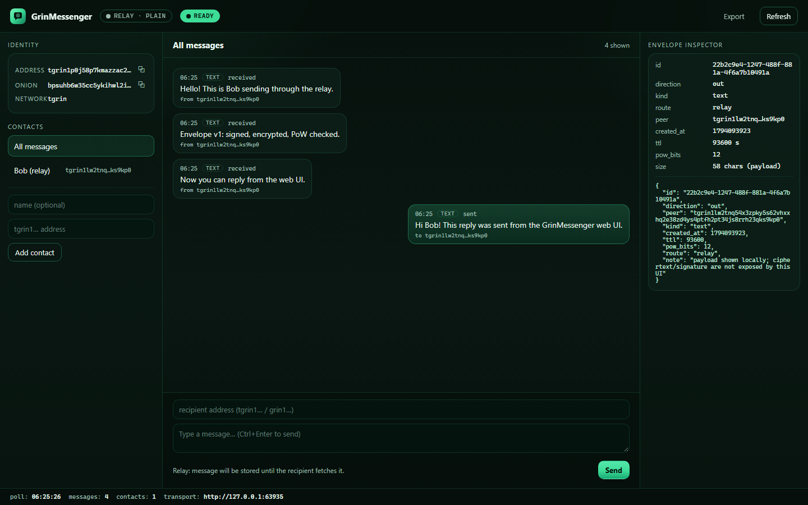
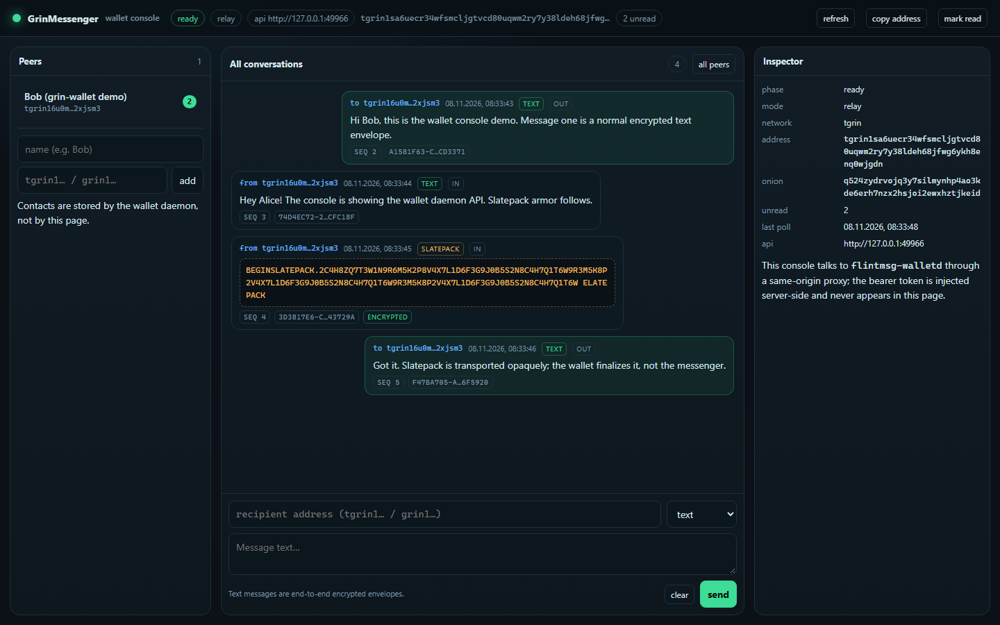

# GrinMessenger

[](https://github.com/DanilaGrinRus/GrinMessenger/actions/workflows/ci.yml)
[](https://danilagrinrus.github.io/GrinMessenger/)
[](https://github.com/DanilaGrinRus/GrinMessenger/releases)

Standalone Grin messenger module, extracted from the
[Flint](https://github.com/DanilaGrinRus/Flint) project: signed and encrypted
envelope messages, direct delivery to a Tor v3 onion through **in-process Arti**,
and an optional store-and-forward relay. No wallet, no Grin node, no RPC and no
GUI are required. A dedicated **wallet integration layer** (Rust API + loopback
sidecar for C++/Qt wallets) is included, see
[docs/WALLET_INTEGRATION.md](docs/WALLET_INTEGRATION.md).

Repository: <https://github.com/DanilaGrinRus/GrinMessenger> ·
Website: <https://danilagrinrus.github.io/GrinMessenger/>

The crates and binaries keep their historical `flint-*` / `flintmsg` /
`flint-relay` names as provenance of the extraction from the Flint messenger;
this is not the Flint wallet.

| | |
|---|---|
| Repository | <https://github.com/DanilaGrinRus/GrinMessenger> |
| Website | <https://danilagrinrus.github.io/GrinMessenger/> |
| License | MIT OR Apache-2.0 (see `LICENSE-MIT`, `LICENSE-APACHE`, `NOTICE`) |
| Upstream | Flint `20efa26a953f83a36ec0fe248e390d0031d01a95` (2026-10-30) |
| Provenance | [PROVENANCE.md](PROVENANCE.md), [evidence/20261107-extraction](evidence/20261107-extraction/) |
| Protocol | [docs/PROTOCOL.md](docs/PROTOCOL.md) |
| Architecture | [docs/ARCHITECTURE.md](docs/ARCHITECTURE.md) |
| Security / audit triage | [docs/SECURITY.md](docs/SECURITY.md) |
| Wallet integration | [docs/WALLET_INTEGRATION.md](docs/WALLET_INTEGRATION.md) |
| Releases / CI | [docs/RELEASE.md](docs/RELEASE.md) |
| Third-party components | [THIRD_PARTY_NOTICES.md](THIRD_PARTY_NOTICES.md) |

Status (2026-11-08): **extraction, adaptation, a local web UI, wallet
integration and security hardening are complete; offline build is PASS, 154
automated tests are PASS (0 failed, 2 ignored), the loopback E2E, real CLI
processes, the web UI, a two-daemon wallet API run, a wallet web console and a
live Tor two-peer direct-onion run on a Google Cloud VM are PASS.** The original
build sandbox has no Tor egress; live Tor was therefore verified on a GCP VM
(Ubuntu, Arti bootstrapped 100%, direct onion delivery + signed ACK), see
[evidence/20261107-extraction/SUMMARY.md](evidence/20261107-extraction/SUMMARY.md)
and [REPORT.md](evidence/20261107-extraction/REPORT.md) (the detailed extraction
report and verifier logs are kept in Russian as historical evidence). Security
findings and residual risks are tracked in [docs/SECURITY.md](docs/SECURITY.md).
This is a DEV/testnet tool: not audited, not ready for mainnet.

## Crates

| Crate | Binary | What it does |
|---|---|---|
| `flint-messenger` | — | envelope v1, crypto, PoW, ACK, store/history/contacts, transports (`GatewayTransport`, `DirectOnionTransport`, Nostr) |
| `flint-tor-arti` | — | in-process Tor: onion v3 from the ed25519 seed, onion service, HTTP client through Arti |
| `flint-gateway` | `flint-relay` | loopback gateway / standalone store-and-forward relay without a wallet |
| `flint-messenger-cli` | `flintmsg` | two-peer CLI: keygen / address / serve / send / fetch |
| `flint-messenger-ui` | `flintmsg-ui` | local web UI: chat, contacts, envelope inspector, transcript export, relay/direct modes |
| `flint-messenger-wallet` | `flintmsg-walletd`, `flintmsg-wallet-ui` | wallet integration layer: embedded service, seed derivation, encrypted history/contacts/read markers, a loopback JSON API sidecar and an optional developer web console |

## Build

Rust for MSVC is required (edition 2021, `rust-version = "1.92"`; verified with
1.99).

```powershell
cargo build --workspace
cargo test --workspace
```

The repository is developed inside `C:\DHW`, where the inherited
`C:\DHW\.cargo\config.toml` replaces crates.io with the offline vendor at
`C:\DHW\vendor`, so the build works without network access. On another machine,
plain `cargo build` will fetch the pinned dependencies from `Cargo.lock`; for a
fully offline build, copy the vendor directory and a `.cargo/config.toml` next to
the project.

`profile.dev` sets `debug = 0` (MSVC chokes on long paths in the dependency
graph). Release build: `cargo build --release --workspace`.

## Quick start: direct mode (Tor/Arti)

A Tor network connection is required (Arti bootstrap; the first run can take
30–150 s). Both peers must be online: direct delivery stores nothing outside the
recipient. For a run without Tor, see relay mode below.

```powershell
# 1) identities (seed files; do NOT publish them)
cargo run -p flint-messenger-cli --bin flintmsg -- keygen --out alice.json
cargo run -p flint-messenger-cli --bin flintmsg -- keygen --out bob.json
cargo run -p flint-messenger-cli --bin flintmsg -- address --identity bob.json
# { "address": "tgrin1…", "onion": "….onion" }

# 2) Bob publishes the onion + loopback gateway and prints incoming JSON lines
cargo run -p flint-messenger-cli --bin flintmsg -- serve --identity bob.json --data bob-data

# 3) Alice sends to Bob's address (the onion is derived from the address)
cargo run -p flint-messenger-cli --bin flintmsg -- send --identity alice.json `
  --to tgrin1… --text "hello over arti"
```

`serve` prints `{"event":"ready",…}` and then one `{"event":"message",…}` line
per message; after printing, the message is acknowledged with a signed ACK. The
first Arti bootstrap of the client/service can take up to 150 s (the timeout is
configurable in `flint-tor-arti`).

## Relay mode (store-and-forward)

```powershell
# relay (loopback for testing; publish it through an onion in production)
cargo run -p flint-gateway --bin flint-relay -- --listen 127.0.0.1:8080 --store relay-store

# send and receive through the relay; --plain = TCP without Tor (loopback/clearnet only)
cargo run -p flint-messenger-cli --bin flintmsg -- send --identity alice.json `
  --to tgrin1… --text "hi via relay" --relay http://127.0.0.1:8080 --plain
cargo run -p flint-messenger-cli --bin flintmsg -- fetch --identity bob.json `
  --source http://127.0.0.1:8080 --plain
```

Without `--plain`, the CLI goes through Arti and can use a `.onion` relay.
`flint-relay` enables `require_pow`, `require_signed_ack` and signed mailbox
fetch proofs (`require_fetch_proof`); messages are opaque envelopes, so the relay
cannot read the plaintext. In-repo clients sign the mailbox fetch automatically;
legacy unsigned clients get `401` from a hardened relay. Relay mode conceals the
payload but not a known sender: envelope v1's outer sender signature lets a relay
test a candidate address (see [docs/SECURITY.md](docs/SECURITY.md)).

## Web UI (local browser)

A local web front-end is included: `flintmsg-ui`. The Rust process serves one
embedded page over loopback HTTP (no Node.js, no WebView2, no CDN). It shows the
chat, encrypted-transport status, contacts and an **envelope inspector** (id,
TTL, PoW bits, route, size), and exports the transcript as JSON.



```powershell
# relay mode (works without Tor; run a local flint-relay first, or use any relay)
cargo run -p flint-messenger-ui --bin flintmsg-ui -- `
  --data ui-data --relay http://127.0.0.1:8080 --plain
# the binary prints UI_URL=http://127.0.0.1:PORT/ — open it in a browser

# direct mode: without --relay the UI starts an Arti onion service (needs Tor)
cargo run -p flint-messenger-ui --bin flintmsg-ui -- --data ui-data
```

The UI creates `identity.json` in the data directory when missing and keeps
`history.json` / `contacts.json` there as owner-only files. It binds to loopback
and prints `UI_URL=http://127.0.0.1:PORT/#token=…`: the per-start session token
is required in `X-Flint-UI-Token` for `/api/*`, the `Host` header must be an
exact loopback name and a present `Origin` must be same-origin (DNS-rebinding /
CSRF guard). Open the printed URL exactly; do not expose the port. `--help` lists
all flags (`--identity`, `--network`, `--listen`, `--relay`, `--plain`,
`--tor-state`, `--poll-secs`).

## Wallet integration

`flint-messenger-wallet` prepares the module for Grin wallets (full contract:
[docs/WALLET_INTEGRATION.md](docs/WALLET_INTEGRATION.md)):

- **Identity** — a Grin slatepack address is `bech32(ed25519 pubkey)`, and the
  messenger uses the same format. Wallets must derive a dedicated 32-byte
  messaging seed from the wallet master seed with
  `derive_messaging_seed` (HKDF-SHA256, domain-separated) and keep spending keys
  out of the messenger process. Reusing the wallet address-key seed would make
  the messenger onion linkable to the published payment address (online-time
  correlation); it is not recommended.
- **Slatepack transport** — wallets post already-encrypted Slatepack armor as an
  opaque payload (`kind: "slatepack"`); the messenger never parses or finalizes
  transactions and has no wallet RPC endpoint.
- **Two integration styles** — embed the typed Rust service (`WalletService`) or
  run the `flintmsg-walletd` sidecar and use its authenticated loopback JSON API
  from C++/Qt (Grin++) or any other language. An optional developer console
  (`flintmsg-wallet-ui`) shows the same API in the browser with the token
  injected server-side.

```powershell
# sidecar for a wallet: loopback only, bearer token, history/contacts encrypted
target\debug\flintmsg-walletd.exe --data wallet-data\messenger `
  --seed-file wallet-data\messenger-seed.hex --network tgrin `
  --relay http://127.0.0.1:8080 --plain --listen 127.0.0.1:0
# prints {"event":"ready","api":"http://127.0.0.1:…","token_file":"…", …}
```

API: `GET /v1/status`, `/v1/identity`, `/v1/capabilities`, `/v1/contacts`,
`/v1/messages`, `/v1/events` (long-poll), `/v1/unread`; `POST /v1/send`
(`text` or `slatepack` armor), `/v1/read`; `DELETE /v1/contacts/<address>`.
Every endpoint except `/v1/health` requires `Authorization: Bearer <token>`;
the daemon refuses non-loopback binds.

Optional developer console over the same API (token never reaches the browser):

```powershell
target\debug\flintmsg-wallet-ui.exe --api http://127.0.0.1:<walletd-port> `
  --token-file wallet-data\messenger\api-token --listen 127.0.0.1:0
```



## Using it as a library

```rust
use flint_messenger::{Address, Identity, MessageKind, Messenger, DEFAULT_TTL_SECS};
use flint_messenger::transport::GatewayTransport;

let identity = Identity::from_seed(seed, "tgrin")?;
let recipient: Address = "tgrin1…".parse()?;
let messenger = Messenger::new(GatewayTransport::new("http://127.0.0.1:8080")?);
let envelope = messenger.send(
    &identity,
    &recipient,
    MessageKind::Text { text: "hello".into() },
    DEFAULT_TTL_SECS,
)?;
# Ok::<(), Box<dyn std::error::Error>>(())
```

To deliver through Arti, implement `flint_messenger::transport::HttpConnector`
on top of `flint_tor_arti::TorHttpClient` (this is what `flintmsg` does) and pass
it to `GatewayTransport::with_connector` / `DirectOnionTransport::with_connector`.
For an external Tor with SOCKS5, `GatewayTransport::with_socks` and
`DirectOnionTransport::new` are preserved.

## Checks

```powershell
cargo test --workspace                                      # unit + integration, no live Tor
cargo test -p flint-messenger-wallet                         # wallet API, console + two-daemon E2E
cargo test -p flint-gateway --test relay_live -- --ignored    # spawns flint-relay (hardened)
```

Run results (commands, PASS/FAIL) are in
[evidence/20261107-extraction/](evidence/20261107-extraction/). Summary:
`cargo build --workspace --offline --locked` — PASS;
`cargo test --workspace --offline --locked` — 154 passed / 0 failed / 2 ignored
(`relay_live`, live Nostr); `cargo fmt --check` — PASS. The web-UI integration
tests spawn a real UI process and a real relay; the wallet integration tests
spawn two real `flintmsg-walletd` processes and a real relay and exchange text +
encrypted Slatepack armor; the wallet console tests cover page/proxy/token
non-exposure and Host/Origin guard. Security fix logs:
[29-security-tests.log](evidence/20261107-extraction/29-security-tests.log),
[30-security-demo.log](evidence/20261107-extraction/30-security-demo.log).

Live Tor was verified on a GCP VM with two real processes: `flintmsg serve`
published an onion through Arti and `flintmsg send` delivered a direct onion
envelope to it; the receiver opened it and sent a signed ACK. Log:
[evidence/20261107-extraction/25-live-tor-gcp.log](evidence/20261107-extraction/25-live-tor-gcp.log).
The project has no in-process "onion service + client in one runtime" self-test:
that setup shares one Tokio runtime and is not representative of two peers.

## Not included

- Wallet, Grin node, owner/foreign API, Slatepack creation/finalization and their
  automatic processing (S1/S2). The integration layer transports wallet-provided
  armor; transaction logic stays in the wallet.
- The Flint desktop Slint wallet UI and the iOS client (the new local web UI is
  included above; iOS needs a separate FFI/staticlib build).
- Groups, attachments, ratchet/forward secrecy, guaranteed offline delivery,
  public abuse control and a custom P2P protocol.
- The Nostr transport exists in the library as a separate delivery option, but
  the v1 CLI/UI/wallet daemon do not enable it.

## Limitations and honest claims

- Protocol v1 has no forward secrecy and no post-compromise protection.
- Relay/direct delivery exposes metadata (recipient address, size, time); the
  relay cannot read the payload, but it can drop or duplicate messages.
- **Relay mode does not hide a known sender from the relay**: the public outer
  envelope signature lets a relay test a candidate address. Use direct mode when
  sender-relay unlinkability matters; a v2 envelope with sender authentication
  inside the payload is future work ([docs/SECURITY.md](docs/SECURITY.md)).
- Direct-mode delivery is finite-capacity: the old shared loopback rate limit was
  replaced by a larger queue + PoW + poll/ACK drain, but a sustained flood can
  still delay messages (no sender-authenticated quota in v1).
- Tor hides the network path but is not a replacement for end-to-end
  encryption — the envelope provides that.
- The project does not claim anonymity, absence of bugs or mainnet readiness.
- The CLI keeps no persistent history/contacts: it is a demonstration tool. The
  wallet daemon keeps encrypted history/contacts/read markers; message history is
  not forward-secret and one identity per daemon is supported.
- Wallet integration does not call wallet RPC: the wallet decides when to create
  or finalize a Slatepack, which keeps the layer usable by grin-wallet, Grin++ and
  other wallets.
- Never reuse the wallet's address-key seed for the messenger unless permanent
  address↔messenger linkability is acceptable; derive a dedicated messaging seed.
